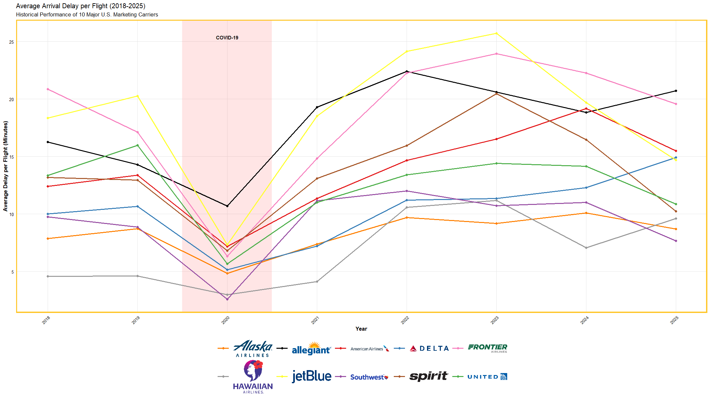
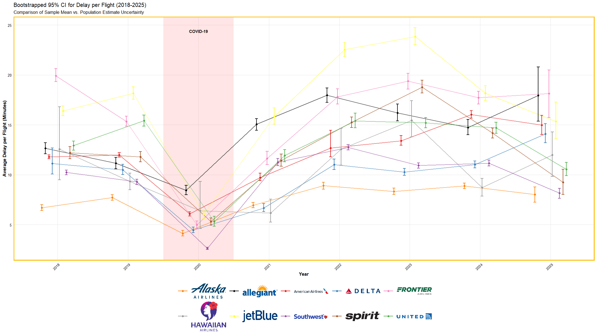
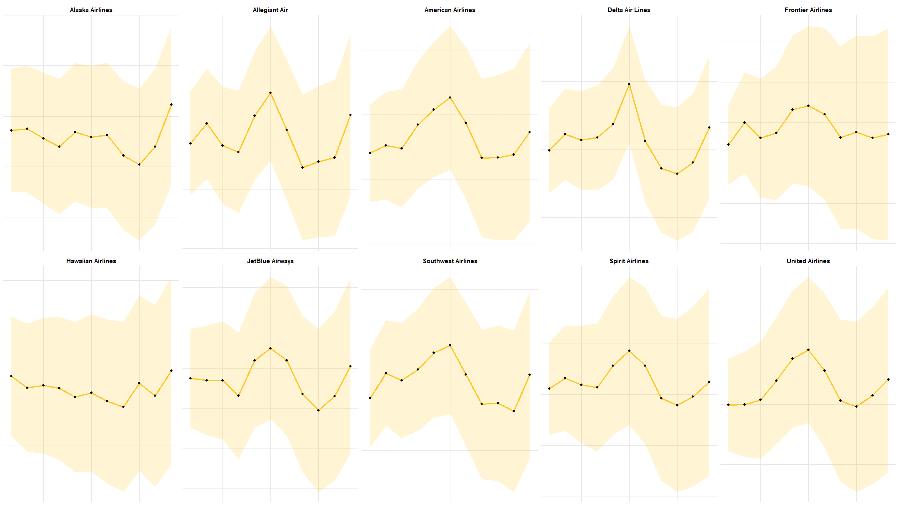

# Airline Delay Analysis (STAT 7100)

Final project for STAT 7100 at Kennesaw State. I wanted to see which U.S. airline actually has the least arrival delay, so I compared the 10 big marketing carriers (American, Delta, United, Southwest, Alaska, JetBlue, Spirit, Frontier, Hawaiian, Allegiant) using BTS on-time data from 2018 to early 2025. It was also my first real stats project, so a lot of it was about applying what we learned in class.

Everything is in R. Mostly base R, with ggplot2 for the plots.

## Data

Airline Delay Cause dataset from the Bureau of Transportation Statistics (I got it off Kaggle). Around 398k rows, one per carrier/airport/month.

The CSV is ~53 MB, so it isn't in the repo. To run the code, download it from [BTS](https://www.transtats.bts.gov/OT_Delay/OT_DelayCause1.asp) or Kaggle and save it as `Airline_Delay_Cause.csv` in the main folder.

Cleaning steps:
- The data lists 51 *reporting* airlines, including regional partners like Endeavor and Envoy. I grouped them under the brand that sells the ticket (Endeavor → Delta, Envoy → American, etc.)
- Some airport codes had more than one airport name, so I fixed those
- Removed 2 rows with negative delays
- Only used 2018 onward, because reporting rules changed in 2018 and that's when all 10 carriers have data

## What I did

1. **Bootstrap confidence intervals** for average delay per flight, by carrier and year. Delay data is very skewed, so I didn't want to assume normality.
2. **Two-way ANOVA** with carrier + airport, to see which one matters more.
3. **Welch's ANOVA** comparing carriers only at airports all 10 of them fly to. The Fligner-Killeen test showed the variances weren't equal, which is why I used Welch.
4. **Holt-Winters forecast** of monthly delays for Feb–Dec 2025 for each airline.

## Results

- Alaska had the lowest delays, with Southwest about 1.3 minutes behind
- Alaska's lead is partly because it doesn't fly as many of the busy summer routes as the others, so Southwest is arguably the more impressive one
- Carrier and airport were both significant, but most of the variance was left unexplained. That makes sense since weather, ATC, etc. aren't in the data
- The forecast picked up the summer peak and a smaller winter peak (icing). COVID in 2020 definitely threw it off a bit
- My rankings lined up pretty well with Cirium's 2024 on-time report

The other plots (individual forecasts, airport heatmap) are in the `figures` folder.

## Files

- `airline_delay_analysis.R` - all the code (cleaning, bootstrap, ANOVA, forecast)
- `docs/Final_Report.pdf` - final write-up
- `docs/Proposal.pdf` - original proposal
- `figures/` - plots

You need `ggplot2` and `ggtext` installed, then run the script from the repo folder.

## If I did it again

I'd try a forecast model that handles the COVID drop better (maybe ARIMA with an intervention term), and control for weather and route density, since those are a big part of the story.
